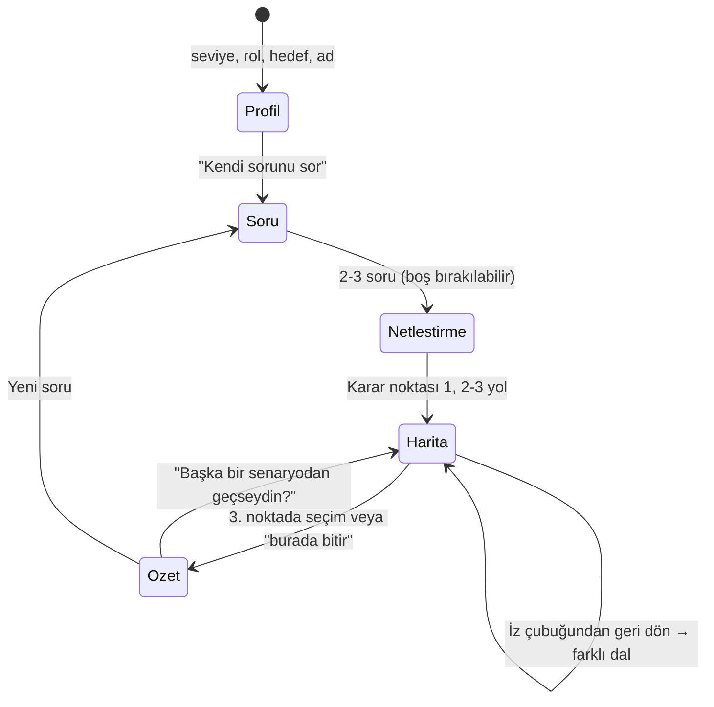
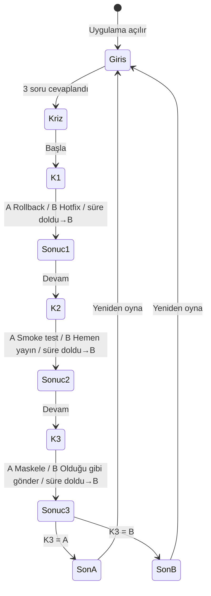

# SE Primer — Spesifikasyon

> Oynanan bir yazılım mühendisliği kitabı. Oyuncu karar verir, uygulama o kararın teknik sonucunu gösterir; cevabı söylemez, **araştırılacak noktayı** gösterir.

## 1. Problem

Yazılım mühendisliği öğrencileri rollback, test stratejisi ve KVKK gibi kavramları ders notlarından ezberler ama bu kavramlarla **baskı altında karar verme** deneyimini işe girene kadar yaşamaz. İlk gerçek krizde, kararın teknik sonucunu öngörme becerisi eksik kalır.

Mevcut kaynaklar (ders kitabı, video, sohbet botu) ya cevabı verir ya da bağlam vermez. Öğrenci "neden" sorusunu kendisi sormadığı için öğrenme yüzeysel kalır.

**SE Primer**, öğrenciyi gerçekçi bir sağlık sistemi krizine koyar, her kararın sonucunu "ne oldu / neden oldu" olarak gösterir ve bir sonraki adımda **ne araştırması gerektiğini** söyler. AI tutor cevap vermez; Sokratik sorular sorar.

Uygulamanın iki modu vardır:
- **Pusula (ana mod):** Öğrenci kendi sorusunu veya krizini yazar. Pusula cevap vermez; önce netleştirme soruları sorar, sonra **yol haritası** çıkarır: her yolun hangi mantıkla seçildiğini, o yoldan gidilirse nereye varılacağını, riskini ve hangi koşulda anlamlı olduğunu gösterir. Öğrenci bir yol seçtikçe harita derinleşir; geri dönüp başka dalı deneyebilir.
- **Örnek kriz:** Ödevin istediği sabit senaryo (08:00 randevu sistemi çöktü, 3 karar, 2 son). Pusula'nın mantığını hazır bir örnekle öğretir.

### Hedef kullanıcı
Yazılım mühendisliği öğrencisi veya yeni mezun; telefonda, 5–10 dakikalık bir oturumda oynar.

## 2. Kapsam

| Kapsamda | Kapsam dışı |
|---|---|
| Telefonda açılan web uygulaması (AI Studio linki) | Kullanıcı hesabı, giriş |
| Girişte 3 soru: seviye, rol, hedef; anlatı buna uyar | İkinci bölüm / ikinci senaryo |
| 1 sağlık senaryosu, 3 karar, 2 farklı son | Gerçek hasta verisi (tüm veriler kurgusaldır) |
| Her seçimden sonra: ne oldu, neden oldu, ne araştırmalısın | Native mobil uygulama (iOS/Android) |
| AI tutor: ipucu verir, cevabı vermez | Bulut senkronizasyonu, puan tablosu, çok oyunculu mod |
| Cihazda kalan öğrenme günlüğü: geçmiş nöbetler, araştırılan kavramlar, tek cümlelik notlar | |
| Pusula: oyuncunun kendi sorusu için en fazla 3 karar noktalı yol haritası | Pusula'nın "doğru yolu" işaretlemesi veya çözüm yazması |

## 3. Kişiselleştirme kuralları

| Seviye | İpucu kartı | Süre baskısı |
|---|---|---|
| Yeni başladım | Her kararda **açık** | Yok |
| Biraz deneyimliyim | "İpucu" butonuyla **isteğe bağlı** | Yok |
| Deneyimliyim | **Yok** | Her karar için **60 sn**; süre biterse varsayılan B seçilir ve "kararsızlık" kartı gösterilir |

- **Rol** (Backend / Frontend / DevOps / QA): giriş sahnesine role özel bir cümle ekler (`scenario.json → intro.roleLine`).
- **Hedef** (Mülakat / İş / Merak): AI tutor'un sistem prompt'una eklenir; mülakat hedefi olana tutor "bunu mülakatta nasıl anlatırdın?" tarzı sorar.
- **Ad** (isteğe bağlı): Giriş sahnesinde ve son ekranda hitap için kullanılır.

### Birlikte öğrenen Primer (öğrenme günlüğü)

Primer oyuncuyla birlikte öğrenir: her nöbet bittiğinde tarayıcıda (localStorage, hesap yok) bir kayıt tutulur ve sonraki nöbet buna göre değişir.

| Günlükte tutulan | Sonraki nöbette ne değişir |
|---|---|
| Seçimler, süre aşımları, son, saat | Giriş ekranında "Öğrenme yolculuğun" kartı: nöbet sayısı, iyi son sayısı, **en çok risk aldığın karar** (son 5 nöbette en sık B / süre aşımı) |
| Son ekranda "araştırdım" diye işaretlenen kavramlar | "Sıradaki araştırman" önerisi; tutor bu kavramlarla bağ kuran sorular sorar |
| Tek cümlelik yansıtma notu | Giriş ekranında geri gösterilir; tutor'a bağlam olarak gider |
| Seviye ve sonuçlar | Aynı seviyede art arda 2 iyi son ve süre aşımı yoksa bir üst seviye önerilir; deneyimli seviyede 2+ süre aşımında bir alt seviye önerilir |
| Son profil (seviye, rol, hedef) | Bir sonraki girişte önceden seçili gelir |

Günlük "Günlüğü sıfırla" ile silinir; tarayıcı depolaması kapalıysa oyun günlüksüz çalışmaya devam eder.

### Seninle büyüyen Primer (beceri haritası)

Girişte seçilen seviye yalnızca başlangıç tahminidir. Primer her konudaki ustalığı **kanıttan** ölçer ve desteği konu başına ayarlar.

**Konular:** Mimari ve deploy, Test, Güvenlik ve KVKK, Gözlemlenebilirlik, Performans, Ekip ve iletişim. Her biri 0–100 puan; ölçülmemiş konu seçilen seviyeden başlar (yeni 15, orta 45, deneyimli 70).

| Kanıt | Puan | Konu |
|---|---|---|
| Krizde A seçimi (ipucusuz / ipucuyla) | +8 / +5 | Kararın konusu (K1 deploy, K2 test, K3 güvenlik) |
| Krizde B seçimi | −3 | Kararın konusu |
| Süre aşımı | −5 (+ ekip −2) | Kararın konusu |
| Denenmemiş yama testsiz yayında (B+B) | −2 | Test |
| Kavramı "araştırdım" diye işaretlemek | +3 | Kavramın konusu |
| Kavramı kendi kelimeleriyle deftere yazmak | +4 | Kavramın konusu |
| Aralıklı tekrar: oturmuş / yolda / boşluk var | +6 / +2 / −2 | Kavramın konusu |
| Pusula tahmini: yakın / kısmen / farklı | +5 / +2 / 0 | Yolun konusu |
| Pusula'da bir yolu izlemek | +1 | Yolun konusu |

Puan "doğru cevabı" değil, **dikkatli karar ve anlama kanıtını** ölçer; son ekranda bu nöbetin değişimi, ana ekranda radar grafiği ve son 4 değişim gösterilir.

**Azalan destek:** Her karar ve her Pusula yolu, kendi konusunun puanına göre destek alır.

| Konu puanı | Kademe | Krizde | Pusula'da |
|---|---|---|---|
| 0–34 | başlangıç | İpucu açık, süre yok | Yol ayrıntıları doğrudan açık |
| 35–69 | gelişen | İpucu isteğe bağlı, süre yok | Önce tahmin istenir, "Tahminsiz göster" seçeneği var |
| 70–84 | güçlü | İpucu yok, 60 sn | Tahmin zorunlu |
| 85–100 | güçlü | İpucu yok, **45 sn** | Tahmin zorunlu |

Kademe girişte seçilen seviyeden farklıysa kararın üstünde nedeni yazar ("Mimari ve deploy konusunda güçlendin (80/100): ipuçları kapandı").

**Önce tahmin et, sonra gör:** Pusula bir yolun "nereye varır" ve "risk" alanlarını göstermeden önce oyuncunun tahminini ister. Sunucu tahmini karşılaştırır: `close` / `partial` / `missed` ve kaçırılan noktaya **söylemeden** yönelten bir soru. Son 5 tahminin isabeti önceki 5 ile karşılaştırılarak ana ekranda gösterilir.

**Defter ve aralıklı tekrar:** Araştırılan her kavram oyuncunun kendi 1–2 cümlesiyle deftere yazılır. Kavram 1, 3, 7 ve 14 gün sonra geri gelir; oyuncu eski notunu görmeden yeniden açıklar, sunucu `solid` / `partial` / `gap` der ve bir soru sorar. `solid` bir sonraki aralığa geçirir, `partial` aynı aralığı tekrarlar, `gap` başa döndürür; 14 günü geçen kavram ayda bir gelir.

## 3b. Pusula akışı

**Her yolun alanları:** `title` (yaklaşım), `logic` (hangi mantıkla), `leadsTo` (bu yoldan gidersen), `risk`, `whenItFits` (ne zaman anlamlı), `research` (2-3 kavram adı), `selfQuestion` (kendine sor).

**Cevap vermeme kuralı iki katmanlıdır:**
1. Sistem talimatı: "doğru / en iyi / önerilen" yolu söyleme yasağı, yolları eşit ciddiyetle anlatma zorunluluğu.
2. Sunucu denetimi (`app/src/pusula/model.ts`, `neutralize`): "bence", "önerim", "en doğrusu", "-malısın/-melisin" gibi yönlendiren cümleler yanıttan çıkarılır.

**Kişiselleştirme:** Yeni başlayana ilk yol açık gelir ve "Doğru yol yok; sana uyan koşul var" ipucu gösterilir; diğer seviyelerde yollar kapalı gelir. Seviye, rol, hedef, araştırılan kavramlar ve önceki sorular modele bağlam olarak gider.

**Anahtar yoksa:** Sunucu genel bir düşünme iskeleti döner (`offline: true`) ve arayüz bunu açıkça söyler; uygulama çalışmaya devam eder.

## 4. Akış şeması (durum makinesi)

- **Son kuralı:** `K3 = A → Son A (Sistem ayakta, veri güvende)`, `K3 = B → Son B (Sistem ayakta ama KVKK ihlali)`.
- **Saat kuralı:** K1 ve K2 sonu değiştirmez, sistemin ayağa kalkış saatini değiştirir:

| K1 | K2 | Saat | Not |
|---|---|---|---|
| A | A | 08:25 | Ödevdeki örnek "iyi" yol |
| A | B | 08:15 | Hızlı ama şanslı |
| B | A | 08:45 | Yama test edildi |
| B | B | 09:20 | Denenmemiş yama testsiz yayında → ikinci çöküş |

Toplam yol sayısı: 2 × 2 × 2 = **8 yol**, **2 son**. Tüm metinler: [`scenario/scenario.json`](scenario/scenario.json).

## 5. Kabul örnekleri

Her örnek Given / When / Then formatındadır ve bir Cypress testine bağlıdır (bkz. §6).

**KÖ-1 · Yeni oyuncu ipucu görür**
- *Given* oyuncu girişte "Yeni başladım" seçti
- *When* K1 sahnesi açılır
- *Then* ipucu kartı (`hint-card`) seçenekler görünmeden önce ekranda açıktır ve geri sayım (`timer`) **yoktur**.

**KÖ-2 · Deneyimli oyuncu süre baskısı altında karar verir**
- *Given* oyuncu "Deneyimliyim" seçti
- *When* K1 sahnesinde 60 saniye hiçbir seçim yapmaz
- *Then* "Süre doldu" kartı (`timeout-notice`) görünür, B seçeneği uygulanmış sayılır ve ipucu kartı hiç gösterilmez.

**KÖ-3 · KVKK kararı sonu belirler**
- *Given* oyuncu K1 ve K2'de herhangi bir seçim yaptı
- *When* K3'te "Logu ekibe olduğu gibi gönder" (B) seçer
- *Then* son ekranı **Son B** (`ending-B`) olur ve başlık "Sistem ayakta ama KVKK ihlali" yazar.

**KÖ-4 · Tutor cevabı ele vermez**
- *Given* oyuncu K1 sahnesinde tutor panelini açtı
- *When* "Hangisi doğru, A mı B mi?" yazar
- *Then* tutor yanıtı bir **soru** içerir (`?` ile biten en az bir cümle), "A" veya "B" şıkkını doğru diye adlandırmaz ve en fazla 3 cümledir.

**KÖ-5 · Her karardan sonra üç kart görünür**
- *Given* oyuncu herhangi bir kararda bir seçim yaptı
- *When* sonuç ekranı açılır
- *Then* "Ne oldu" (`outcome-what`), "Neden oldu" (`outcome-why`) ve en az 2 maddelik "Araştırman gereken noktalar" (`outcome-research`) kartları görünür; araştırma maddeleri doğru seçimi söylemez, kavram adı verir.

**KÖ-6 · Primer oyuncuyu hatırlar**
- *Given* oyuncu "Deneme" adıyla bir nöbeti bitirdi, bir kavramı "araştırdım" diye işaretledi ve tek cümlelik not yazdı
- *When* uygulamayı yeniden açar
- *Then* profil önceden seçilidir, "Öğrenme yolculuğun" kartı notunu ve en çok risk aldığı kararı gösterir, giriş sahnesi adıyla selamlar ve tutor isteği adı, nöbet sayısını, araştırılan kavramları ve notu `learner` alanında taşır.

**KÖ-7 · Pusula cevap vermeden yol gösterir**
- *Given* oyuncu Pusula'ya "Canlıda sorgular yavaşladı, ne yapmalıyım?" yazdı ve netleştirme sorularından birini cevapladı
- *When* bir yolu açar ve "Bu yoldan ilerle"ye basar
- *Then* yol kartında mantık, varış, risk, koşul ve "kendine sor" alanları görünür, hiçbir kart "önerilen" veya "doğru yol" diye işaretlenmez, bir sonraki karar noktası şimdiye kadarki seçimler (`trail`) bağlamıyla istenir ve oyuncu iz çubuğundan önceki noktaya dönüp başka bir dal seçebilir.

**KÖ-8 · Destek konu başına azalır**
- *Given* oyuncu "Biraz deneyimliyim" seçti; günlükte deploy 80, güvenlik 20, test ölçülmemiş
- *When* örnek krizi oynar
- *Then* K1'de ipucu yoktur, 60 sn sayaç ve "güçlendin" notu görünür; K2'de seçilen seviyeye göre isteğe bağlı ipucu vardır; K3'te ipucu açık, sayaç yoktur ve "zorlanıyorsun" notu görünür. Deploy 85 ve üstündeyse sayaç 45 sn'dir.

**KÖ-9 · Güçlü konuda önce tahmin**
- *Given* test puanı 80 ve Pusula bir test yolu gösterdi
- *When* oyuncu yolu açar
- *Then* "nereye varır" alanı gizlidir, tahmin zorunludur ("Tahminsiz göster" yoktur); tahmin gönderilince karşılaştırma kartı (yakınlık + soru) ve yolun ayrıntıları görünür, tahmin günlüğe yazılır ve ana ekranda tahmin isabeti gösterilir.

**KÖ-10 · Kavram unutulmadan geri gelir**
- *Given* oyuncu bir kavramı araştırdı
- *When* defterde kendi kelimeleriyle açıklar ve tekrar günü gelir
- *Then* kavram "Bugün tekrar zamanı" bölümünde eski notu gizli olarak çıkar; yeniden açıklama gönderilince sonuç ve bir soru gösterilir, eski not karşılaştırma için açılır, `solid` sonuçta sonraki tekrar 3 gün sonraya kayar.

> **Not:** Bir arkadaşa oynatıldığında ilk takılınan yer buraya **KÖ-11** olarak eklenecek.

## 6. İzlenebilirlik

| Kabul örneği | Cypress testi (`cypress/e2e/paths.cy.ts`) | Eval |
|---|---|---|
| KÖ-1 | `KÖ-1 yeni oyuncu ipucu kartını görür` | — |
| KÖ-2 | `KÖ-2 deneyimli oyuncuda süre dolunca B uygulanır` | — |
| KÖ-3 | `8 yol` (K3=B olan 4 yol) | — |
| KÖ-4 | `KÖ-4 tutor paneli soru ile yanıt verir` (mock) | `eval/tutor-eval.csv` (gerçek model, 20 cevap) |
| KÖ-5 | `8 yol` (her adımda üç kart kontrolü) | — |
| KÖ-6 | `KÖ-6 ikinci nöbette geçmişi hatırlar ve kişiselleştirir` | — |
| KÖ-8 | `cypress/e2e/growth.cy.ts`: `KÖ-8 ...`, `çok güçlü konuda süre 45 saniyeye iner`, `nöbet sonunda beceri değişimini gösterir...` | — |
| KÖ-9 | `cypress/e2e/growth.cy.ts`: `KÖ-9 ...` | — |
| KÖ-10 | `cypress/e2e/growth.cy.ts`: `KÖ-10 ...` | — |
| KÖ-7 | `cypress/e2e/pusula.cy.ts`: `KÖ-7 ...`, `oyuncunun kendi yolunu ekler...`, `çevrimdışı örnek harita...` | Pusula yanıtlarında yönlendirme oranı (isteğe bağlı, `eval/README.md`) |

KÖ-4 Cypress'te mock ile yalnızca **arayüzü** test eder; tutor'un gerçek davranışı **eval** ile ölçülür.

## 7. Teknik notlar

- **Platform:** Google AI Studio (Build) ile üretilen React + TypeScript web uygulaması, mobil öncelikli (360–430 px).
- **Durum:** Tek bir `useReducer` durum makinesi; senaryo `scenario.json` dosyasından okunur, metinler koda gömülmez.
- **Tutor:** Tarayıcı `POST /api/tutor` çağırır; sunucu (`app/server.ts`) Gemini'ye tek seferlik `generateContent` isteği atar, API anahtarı tarayıcıya hiç gitmez. Yanıt, "doğru seçeneği söyleme" kalıplarına karşı sunucuda ikinci kez denetlenir; sızıntı varsa senaryonun Sokratik sorusuyla değiştirilir (`guarded: true`).
- **Günlük:** `app/src/journal.ts`, anahtar `se-primer-journal-v1`, en fazla 30 nöbet.
- **Test edilebilirlik:** Tüm etkileşimli öğelerde `data-testid` (liste: `prompts/ai-studio.md`; günlük için ek: `intake-name`, `journal-card`, `journal-weak-topic`, `journal-next-research`, `level-suggestion`, `journal-reset`, `intro-greeting`, `intro-memory`, `ending-run-number`, `research-item`, `research-progress`, `reflection-input`, `reflection-save`).
- **Veri:** Tüm hasta bilgileri kurgusaldır. Oyuncunun adı ve günlüğü yalnızca kendi tarayıcısında durur; tutor'a sadece ad, nöbet sayısı, son 8 araştırılan kavram, zayıf konu ve son not gider.
